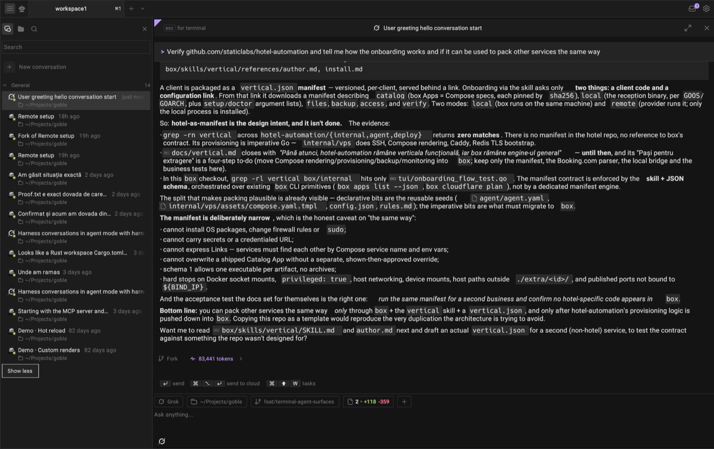

<p align="center">
  
  <br>
  <strong>A harness for agents, with remote sandboxes and a gateway.</strong>
  <br><br>
  <a href="LICENSE"></a>
  
  
</p>

## Install

macOS and Linux:

```sh
curl -fsSL https://get.octomus.dev/install.sh | sh
```

Windows (PowerShell):

```powershell
irm https://get.octomus.dev/install.ps1 | iex
```

The installer puts `Goble.app` in `~/Applications` on macOS and the AppImage in
`~/.local/bin` on Linux. Releases also ship as `.dmg`, `.deb`, `.tar.gz` and
`GobleSetup.exe` on [the releases page](https://github.com/AdrianTuci1/goble/releases).

<p align="center">
  
</p>

## What it does

- Runs the agent harness you already use in real terminal panes, with transcripts, tool calls and
  sub-agents beside the prompt that produced them.
- Keeps a per-turn ledger, so any turn can be forked, replayed or reverted.
- Runs locally, in a remote sandbox on Modal, E2B, Daytona, Cloud Run, Docker or SSH, or through a
  gateway the phone app pairs with.

Configuration, remote access and the phone client are documented in `~/.goble/docs/user-guide` and
in [`docs/`](docs): [architecture](docs/ARCHITECTURE.md),
[substrate](docs/substrate-architecture.md), [remote sandboxes](docs/remote-sandboxes.md),
[mobile client](docs/mobile-remote.md).

## Build from source

```sh
rustup toolchain install stable
cargo build --release -p goble-app
./scripts/dev-ui.sh   # builds and launches the app
```

The terminal core is vendored under `vendor/alacritty_terminal`; restore it with
`./scripts/fetch-alacritty-terminal.sh --install` if your checkout lacks it. Packaging recipes are
in [`packaging/`](packaging/README.md).

## License

MIT. The vendored `alacritty_terminal` is Apache-2.0; its notice is in
[`THIRD-PARTY-NOTICES.md`](THIRD-PARTY-NOTICES.md).
