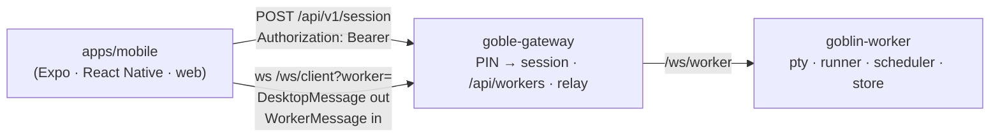

# The phone against a gateway

`apps/mobile` is a client of the same gateway the browser client uses. Behind a
gateway it is a window on the worker: a real shell, agent turns, and the worker's
own agents, routines and conversations. Without one it stays on the demo
workspace, so every screen is still reviewable.

This document records what the phone sends, what it expects back, and which
parts of the reference clients (T3 Code mobile, Paseo) shaped it.

## Pairing

The phone pairs once and keeps the session:

1. `GET /health` — is the gateway reachable.
2. `POST /api/v1/session {pin}` → `{token, expires_in}`.
   A PIN that does not verify answers `401 {"error":"wrong_pin"}`.
3. Every request carries `Authorization: Bearer <token>`; the relay WebSocket
   carries the same header on its handshake, which a native client can set.

A gateway build without `/api/v1/session` answers `404`; the phone then posts the
PIN to `/login` and keeps the browser cookie — the same session, held by the
platform. That fallback only covers a page served from the gateway's own origin
(the cookie is `HttpOnly; SameSite=Strict`). Native is the target for the token
path; the browser build reaches the gateway through the same origin it is served
from.

`lib/remote/gateway.ts` owns the two calls, `lib/remote/connection.ts` keeps the
session, the worker list and the socket, and `lib/remote/socket.ts` reconnects
with a 500 ms → 8 s backoff.

## Frames

The relay copies frames verbatim, so the phone speaks `goble-core::protocol`:
one JSON object per frame, tagged by `kind`. `lib/remote/protocol.ts` holds the
subset the phone uses and the base64 plumbing a pty needs (`pty_input.data` and
`pty_output.data` are base64 of raw bytes, not text).

The worker fans every frame out to every attached client. The phone therefore
filters: a turn listens for its own `trace_id`, a pane for its own `pane_id`.

Reads have no request id of their own, so `lib/remote/entities.ts` pairs the
`kind` it asked for with the `kind` that answers it and returns a promise with an
8 s timeout:

| Ask | Answer |
| --- | --- |
| `query_entities {entity_type:"agents"}` | `entity_list {entity_type:"agents"}` |
| `query_entities {entity_type:"chats"}` | `entity_list {entity_type:"chats"}` |
| `list_scheduled_tasks` | `scheduled_tasks` |

## Terminal

Terminal mode is the shell, on the phone, in both builds: the demo workspace says
a shell opens once a gateway is paired.

* `open_pty {pane_id, cwd:"", cols, rows}` — an empty `cwd` lands in the
  worker's workspace (`GOBLE_WORKSPACE_PATH`, then `GOBLIN_WORKSPACE_ROOT`, then
  its own directory).
* `pty_input {pane_id, data}` carries keystrokes; Return is `\r`, and the key bar
  sends `esc`, `tab`, `ctrl-c` and the arrows, which a touch keyboard cannot type.
* `pty_resize` follows the measured output area, so a wrapped line is folded by
  the shell instead of by the view.
* The pane belongs to the relay socket that opened it and dies with it. A screen
  that reconnects opens a fresh pane rather than waiting for an id that is gone.

`lib/remote/terminal.ts` folds the byte stream into lines: printable characters
overwrite at a cursor (so a `\r` progress bar stays on one line), carriage
return, newline and backspace move it, and escape sequences are consumed —
colours, cursor moves and the alternate screen are left to the desktop, which
owns the full terminal. `components/terminal-surface.tsx` draws those lines in
monospace with the key bar and a line input. T3 Code does the same in its text
fallback; its native surface is a Ghostty module this app does not have.

## Threads

A message from the phone is
`run_agent_for_thread_reply {trace_id, thread_id, agent_id, prompt, spec, mcp_servers}`.
`thread_id` is the session id in the route, so the conversation the drawer lists
is the one the screen opened.

The worker stores the conversation under `thread_id` in its SQLite store: the
first message names it, every user message and every assistant answer is a row,
and the next turn injects the transcript tail in front of the new message. This
makes history outlive the app and makes a second device see the same thread.

While the turn runs, `assistant_delta`, `tool_call_*`, `ask_user`,
`agent_finished` and `thread_agent_reply` arrive on the relay; the phone streams
them into the open transcript. `thread_agent_reply` fills in the answer for a
harness that reports it only at the end.

A turn that pauses on a question or a command proposal does not finish its
trace and stores no answer: the decision settles it, and the continuation is the
one that is stored. `thread_agent_reply` therefore only follows a settled run.

A turn that never starts is a visible failure: the worker answers an error with
that trace's `agent_log` and `agent_finished`, and the phone also gives up after
8 s without `agent_started` — an empty bubble is never the end state.

`query_entities {entity_type:"chats"}` returns the stored conversations, newest
first, capped at 50, each with its messages. The drawer lists them; a session
screen loads its thread from there when it opens.

## Questions

`ask_user` pauses the turn. The phone draws the question above the composer with
its quick replies and a free-text field; an answer is `answer_user {trace_id,
answer}`, which the worker turns into the daemon's `Resume`. The continuation
streams under the same trace id, the worker stores it in the same thread and
reports `agent_finished` when it settles.

## Approvals

A command tool suspends the turn before it runs. The worker forwards the
daemon's `CommandProposed` as `command_proposed {trace_id, id, candidates,
cwd}` and the phone draws "Run this command?" above the composer: the proposed
lines are chips, and the line that will run is the card's editable field, so a
rewrite becomes an edit.

The decision is `answer_command {trace_id, decision}`, where `decision` carries
`goble-core`'s adjacent-tagged `CommandDecision`: `{type: "approve", payload}`,
`{type: "edit", payload}` or `{type: "reject", payload}` with the reason. The
worker turns it into the daemon's `ResumeCommand`; the harness runs the line or
fails the call, and the continuation streams under the same trace and settles
the thread reply like an answered question.

The transcript row the proposal appended reads "Waiting" until the decision,
then "Ran" with the decided line, or "Skipped" with the reason. The first wait
ends on a proposal the same way it ends on a question, so a run that proposes a
command no longer holds the worker's turn open.

The desktop app still answers approvals only on its own daemon; a remote worker's
proposal needs the desktop's answer path to send `answer_command` as well.

## Attachments

An image picked in the composer — Home or a session — travels to the worker as
`upload_attachment {upload_id, name, data}`, `data` being base64 of the file.
The worker decodes up to 16 MiB, writes it to
`<workspace>/attachments/<upload_id>-<safe name>` and answers
`attachment_stored {upload_id, path}` or the reason it refused. The name is
reduced to one path component, so an upload cannot leave that directory.

The phone waits for that answer (20 s) and puts the path in the turn:

    what is in this picture?

    [Attached image: /workspace/attachments/upload-…-shot.png]

The agent then reads the file from the workspace with the tools it already has.
The bubble keeps the local URI, so the transcript shows the picture itself, and
a failed upload turns the reply red with the worker's reason instead of starting
a turn that cannot see the file. Home hands the picked image to the session it
opens through `lib/pending-attachment.ts`, because a route string has room for
the preview URI only.

## Agents and routines

* Agents: `query_entities {entity_type:"agents"}` lists them; a row edits name,
  summary, instructions and tool scope and writes `update_agent
  {agent_id, spec}`. The worker upserts the spec into its store and its memory
  map. `remove_agent` deletes the row.
* Routines: `list_scheduled_tasks` lists the scheduler's routines;
  `cancel_scheduled_task` drops one. Creating a routine stays on the desktop,
  where it can name an agent and a cadence.

Both screens keep the demo list when the phone is not paired, so the layout can
be reviewed without a gateway.

## Alerts

`expo-notifications` raises two kinds of banner: a run finished and the agent
needs a decision. Both are for a turn nobody is watching. On the session screen
they fire only when the screen is unfocused (`useFocusEffect`) or the app is not
in the foreground (`AppState`); a turn on screen is its own feedback.

A turn whose screen is closed before it ends is kept alive in `chat.ts`: the
worker keeps running, and the module-level watcher holds the trace and the
conversation title and raises the same alerts when the frame arrives. That is
what makes "start a turn, leave the screen" report back.

Delivery while the app is suspended still depends on the OS keeping the socket
alive until the frame arrives; a push sender on the gateway is the piece that
would make it unconditional.

## Voice

The dictation bar is a real round trip now, transcribed on the worker:

1. `expo-audio` records a segment of about 2.6 s (`lib/recorder.ts`). Mono,
   16 kHz, 64 kbps; native lands in `.m4a`, web in the `MediaRecorder`'s
   container. Each segment is a complete recording — the recorder is stopped
   and a new one opened — so every upload stands on its own.
2. The bytes go out as `transcribe_audio {request_id, provider, model, mime,
   data}`, naming the provider and model chosen under Settings → Voice. The
   phone holds no speech key.
3. The worker resolves a key from its vault — `voice_api_key` for that
   provider, falling back to `llm_api_key` for the same provider — and calls
   OpenAI's `/v1/audio/transcriptions` or ElevenLabs' `/v1/speech-to-text`
   with a hand-written multipart body (the workspace's `reqwest` has no
   `multipart` feature). It answers `transcription_result {request_id, text}`
   or `{request_id, error}`.
4. `lib/dictation.ts` appends each transcript to the words before it and calls
   the composer with the running text, so the gradient reacts per word and the
   transcript never loses an earlier segment. Stop closes the last segment and
   waits for its answer before placing the text in the composer.

Muting stops the microphone and drops the segment in progress; unmuting opens
a new one. Without a live worker link the bar closes with "The worker link is
not live", because transcription happens on the worker. The mode hint under
the composer carries the reason when a provider refuses.

Setup: on the worker, store a `voice_api_key` secret with `provider = "openai"`
or `"elevenlabs"` (an OpenAI `llm_api_key` already works for the OpenAI
models). `expo-audio` is a native module, so a dev-client build is needed for
the phone; Expo web records through `MediaRecorder` with the same code.

## Not covered yet

* Providers beyond OpenAI and ElevenLabs: `lib/voice.ts` lists Fish Audio and
  Cartesia, but the worker has no transcription call for them and says so.
  Cartesia is already marked as unable to transcribe.
* Text to speech: `speakReplies` is a stored preference with no player behind
  it.
* Desktop answers for remote runs: the worker protocol carries `answer_user`
  and `answer_command`, but the desktop's chat surfaces read asks from its own
  daemon, so a question raised by a remote worker has no card to answer there
  yet.

## Checks

`npx tsc --noEmit` in `apps/mobile` is the only compile check the app has.
The Rust half of this work — `/api/v1/session` and bearer sessions in
`goble-gateway`, `answer_user`, the thread store and the `chats` entity in
`goblin-worker` — was **not compiled locally**; CI builds it.

The phone was verified in the browser against a running gateway and worker:
pairing with a PIN, a shell that ran `echo`, the worker's agent and routine
lists, the "Working…" state, and the reason shown for a run the worker refused.
The approval card was exercised with a `command_proposed` frame injected into
the phone's own socket, because the installed worker predates the frame; the
three decisions reached the relay as `approve` (on the second candidate),
`edit` and `reject`, and the resumed half needs the rebuilt worker.

Attachments were exercised the same way, with `attachment_stored` answering the
phone's `upload_attachment`: Home picked a PNG, the frame carried its bytes, and
the turn's prompt named the path the worker would have written. The worker's
own write and its name sanitizer are covered by tests but have not run here.

The transcription frames were exercised in the browser with
`transcription_result` injected into the phone's socket: segments left as
`transcribe_audio` with the chosen provider, model and container, and the text
came back into the composer. The worker's multipart body, key resolution and
provider calls have unit tests in `crates/goblin-worker/src/transcribe.rs`
(wiremock for the HTTP side); they have not been compiled or run locally.
